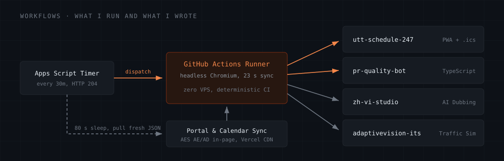

Computer Science student at **UTT** (University of Transport Technology), Hanoi. Most of what I
build starts from an everyday friction point — a noisy pull request, an unlocalized technical video,
or a university portal with no calendar export — and turns into an automated pipeline that runs
reliably without babysitting.

Focused on **systems programming, deterministic developer tooling, and applied AI workflows** in
TypeScript, Python, and C/C++.

## Things I actually debugged

| Symptom | Root cause | Result |
| :--- | :--- | :--- |
| **34 of 40** class sessions vanishing after sync | Upstream Oracle package (`LayDSLichCaNhan`) reuses a single `IDLICHHOC` across every weekly occurrence of a recurring slot — `Map` keyed by ID overwrote Weeks 0–4 with Week 5 | Composite key (`id + date + startTime`), **40/40** kept |
| Scheduled `:00` / `:30` syncs drifting **18–42 min** | Global GitHub Actions queue saturation on `*/30` cron boundaries, plus Vercel Hobby blocking `actions@users.noreply` commits on private repos | Apps Script `workflow_dispatch` wakeup (**1.0 s** HTTP 204) + owner git identity |
| Encrypted portal payloads (`{ A }` / `Data.B`) | Student portal wraps requests/responses in dynamic `CryptoJS` (`AE`/`AD`) keyed by per-session `edu.system.iM` injected server-side | Invoked `edu.system.makeRequest` in-page via headless Chromium — **23 s** full sync |
| Stale PWA shell surviving fresh deployments | Service Worker `stale-while-revalidate` served cached `index.html` and `app.js` on first visit, requiring two reloads | Switched shell & JSON routes to network-first with offline cache fallback |
| Raw `ORA-01403: no data found` leaking into UI & `.ics` | Upstream PL/SQL procedure concatenates unhandled exception strings directly into `TENLOPHOCPHAN` | Stripped `ORA-\d+` lines in normalizer before diffing and iCalendar folding |

## Selected work

**[pr-quality-bot](https://github.com/kindcora/pr-quality-bot)** — `TypeScript` `GitHub Actions` · [Marketplace](https://github.com/marketplace/actions/pr-quality-bot)
Reusable GitHub Action for deterministic pull-request quality and change-risk checks. Evaluates test
signals, dependency/lockfile changes, sensitive file paths, and diff blast radius without relying on
non-deterministic LLM guesses.

**[zh-vi-studio](https://github.com/kindcora/zh-vi-studio)** — `JavaScript` `Python` `FFmpeg` `Audio Separation`
End-to-end Chinese-to-Vietnamese video localization studio: isolates vocals from background stems,
translates subtitles with domain-specific glossaries, and muxes expressive Vietnamese dubbing back
over preserved ambient audio.

**[adaptivevision-its](https://github.com/kindcora/adaptivevision-its)** — `TypeScript` `Simulation`
Interactive smart traffic-light intersection simulator with adaptive phase timing, priority/emergency
vehicle preemption, and reproducible evaluation scenarios.

**[gdqpan-quiz-v2](https://github.com/kindcora/gdqpan-quiz-v2)** & **[tracnghiem](https://github.com/kindcora/tracnghiem)** — `JavaScript` `Playwright` `PWA`
Offline-ready Vietnamese exam practice platforms and interactive physics labs with timed mock tests,
mistake review queues, and persistent local progress.

<b>Private &amp; operational systems — happy to walk through any of it</b>

 

| Project | What it is | Stack |
| :--- | :--- | :--- |
| **utt-schedule-247** | Zero-VPS 24/7 class & exam monitor for `daotao.utt.edu.vn`: headless Playwright sync, diff engine, Telegram HTML alerts, RFC 5545 `.ics` feed, 30-min Google Calendar sync, and PIN-locked offline PWA | `Node.js` `Playwright` `GitHub Actions` `Apps Script` |
| **MultiPost Studio** | Desktop workflow tooling and documentation ([guide](https://kindcora.github.io/multipost-studio-pages/)) for multi-platform video scheduling and publishing on Windows | `HTML` `Automation` |
| **Telegram &amp; internal bots** | Task automation, notification pipelines, and data parsers built for personal study and team workflows | `Python` `Node.js` |

## Stack

| | |
| :--- | :--- |
| **Daily** | TypeScript, JavaScript, Python, C / C++ |
| **Tooling &amp; CI** | Node.js, GitHub Actions, Playwright, Linux, Git, Docker |
| **Also used** | C#, Java, MySQL, Google Apps Script, FFmpeg, Applied LLM Pipelines |

## Connect

[kindcora@protonmail.com](mailto:kindcora@protonmail.com) · [Telegram](https://t.me/kindcora1) · [LinkedIn](https://www.linkedin.com/in/h%C3%A0-%C4%91%C4%83ng-ho%C3%A0ng-808633350/)

The repos on this profile are a mix of tools I maintain, experiments from coursework, and forks I read to learn. <b>The pinned ones are the ones I would actually show you.</b>
